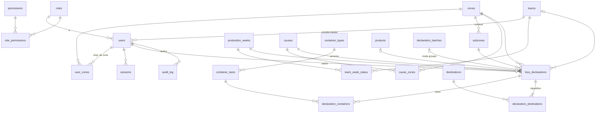

# Schéma de base de données (initial — Phase 1)

PostgreSQL. Clés primaires `uuid` pour les données métier, `smallint`/`text` codé pour les petits référentiels.
Toutes les tables de référentiel ont `active boolean` (désactivation, jamais suppression) et `created_at`,
`updated_at`.

Les tables des phases suivantes sont listées en fin de document pour montrer que le modèle les accueille
sans rupture.

## 1. Diagramme (Phase 1)

## 2. Tables

### Utilisateurs et droits

**roles** — `code` PK (`equipe`, `resp_zone`, `resp_production`, `admin`, `direction`), `label`.

**permissions** — `code` PK (ex. `declaration.create`, `declaration.read.team`, `referentiel.manage`), `label`.

**role_permissions** — (`role_code`, `permission_code`) PK. Matrice centralisée, initialisée par seed.

**users**
| Colonne | Type | Remarque |
|---|---|---|
| id | uuid PK | |
| login | text unique | ex. `equipe-a` |
| display_name | text | |
| password_hash | text | Argon2id |
| role_code | FK roles | |
| team_id | FK teams, null | obligatoire si rôle `equipe` (contrainte CHECK) |
| must_change_password | bool | |
| active | bool | |
| last_login_at | timestamptz | |

**user_zones** — (`user_id`, `zone_id`) PK : zones d'un responsable de zone.

**sessions** — `id` (hash du jeton) PK, `user_id`, `expires_at`, `created_at`, `user_agent`.

### Organisation

**teams** — `id`, `letter` (A–H, unique), `color_name`, `color_hex`, `usual_start`, `usual_end` (time),
`managers_label` (texte libre « Sarah / Lahcen »), `display_order`, `active`.

**team_week_status** — (`team_id`, `production_week_id`) PK, `active` bool, `note`. Absence de ligne = active.

**production_weeks** — `id`, `year` smallint, `number` smallint, `start_date` (jeudi), `end_date` (mercredi),
unique (`year`,`number`), unique `start_date`, CHECK `end_date = start_date + 6`, contrainte d'exclusion
anti-chevauchement.

**zones** — `id`, `code` unique, `name`, `display_order`, `requires_justification` (pour « Autre »), `active`.

**subzones** — `id`, `zone_id`, `code`, `name`, `display_order`, `team_mode`
(`equipe`|`zone`), `active`. Les méthodes de mesure proposées par sous-zone seront ajoutées si le besoin se confirme.

### Référentiels de saisie

**units** — `code` PK (`kg`, `g`, `l`, `ml`, `piece`, `barquette`, `contenant`, `gastro`…), `label`,
`kind` (`masse`|`volume`|`comptage`), `to_base_factor` (vers kg, L ou 1 selon la famille), `active`.

**products** (référentiel simple en Phase 1, enrichi en Phase 2)
| Colonne | Type | Remarque |
|---|---|---|
| id | uuid PK | |
| category | enum | `matiere_premiere`, `sous_recette`, `recette`, `produit_fini`, `produit_externe`, `consommable` |
| external_id | text, null | identifiant Melba stable |
| code | text, null | code interne |
| name | text | |
| variant | text, null | |
| default_unit | FK units | |
| unit_weight_kg | numeric, null | jamais inventé |
| density_kg_per_l | numeric, null | jamais inventé |
| source | text | `manuel`, `import_melba`… |
| active | bool | |

Unicité : (`external_id`) si non nul ; (`category`,`code`) si non nul. Index trigramme sur `name` pour la recherche.

**causes** — `id`, `code`, `name`, `description`, `is_other` (cause « Autres pertes », toujours disponible),
`status` (`proposee`|`active`|`rejetee`|`inactive`), `proposed_by` FK users null, `proposed_at`,
`reviewed_by`, `reviewed_at`.

**cause_zones** — (`cause_id`, `zone_id`) PK.

**destinations** — `id`, `code`, `name`, `kind` (`destruction`|`compost`|`don`|`personnel`|`vente`|
`reutilisation`|`retour_fournisseur`|`autre`), `financial_recovery` bool, `display_order`, `active`.

**container_types** — `id`, `code`, `name` (ex. « Gastro 4 – profond »), `kind` (`gastro` | `support` pour les
échelles), `max_count` (capacité de l'échelle), `active`.

**container_tares** — `id`, `container_type_id`, `unit_tare_kg`, `valid_from`, `valid_to` null, `source`,
`created_by`. La tare totale est proportionnelle au nombre de gastros (vérifié sur le fichier de référence).
Une modification de tare = nouvelle ligne (version) ; l'ancienne est clôturée.

### Déclarations

**declaration_batches** — `id`, `created_by`, `created_at`, `defaults` jsonb (zone, sous-zone, équipe, date
communes), `closed_at`.

**loss_declarations**
| Colonne | Type | Remarque |
|---|---|---|
| id | uuid PK | |
| status | enum | `brouillon`, `validee`, `corrigee`, `annulee` |
| occurred_on | date | date réelle |
| occurred_time | time, null | heure réelle si connue |
| declared_at | timestamptz | horodatage de saisie |
| production_week_id | FK | déduite de `occurred_on` via le calendrier |
| declared_week_id | FK | semaine de `declared_at` |
| is_late | bool | `declared_week ≠ production_week` |
| zone_id, subzone_id | FK | |
| team_id | FK, null | |
| responsibility | enum | `equipe` ou `zone` (déduit du `team_mode` de la sous-zone) |
| created_by | FK users | |
| batch_id | FK, null | mode groupé |
| product_id | FK, null | null si produit hors référentiel (libellé libre, à revoir en Phase 2) |
| product_category | enum | instantané |
| product_name, product_external_id, product_code, product_variant | text | **instantanés** |
| quantity | numeric | quantité saisie (brute si gastro) |
| unit_code | FK units | |
| tare_total_kg | numeric, null | |
| net_quantity | numeric | dans `unit_code` (ou kg si gastro) |
| net_kg | numeric, null | null si non convertible |
| kg_status | enum | `pese`, `converti`, `non_converti`, `sans_objet` (consommables) |
| conversion_factor_used | numeric, null | poids unitaire ou densité utilisé (instantané) |
| measurement_method | enum | `pesee`, `estimation_contenant`, `comptage`, `conversion_reference`, `estimation_manuelle` |
| cause_id | FK | |
| comment | text, null | |
| destination_gap_justification | text, null | si la répartition ne tombe pas juste |
| cost_* | numeric, null | **colonnes réservées Phase 3** (alimentaire, main-d'œuvre, emballage, indirect, méthode, date de calcul) |
| row_version | int | verrou optimiste pour les corrections concurrentes |

Index : (`production_week_id`, `team_id`), (`zone_id`, `production_week_id`), (`cause_id`), (`product_id`).

**declaration_revisions** — `id`, `declaration_id`, `revision` (1, 2, 3…), `data` jsonb (copie complète de la
déclaration, de ses tares et de ses destinations à cette version), `status`, `changed_by`, `changed_at`, `reason`.
Unicité (`declaration_id`, `revision`). Insertion seule.

**declaration_containers** — `id`, `declaration_id`, `container_tare_id` (ligne de tare utilisée, qui porte
le type, le nombre et la version), `count`, `tare_kg_snapshot`.

**declaration_destinations** — `id`, `declaration_id`, `destination_id`, `quantity`, `unit_code`, `net_kg` null,
`recovered_amount` numeric null (Phase 3).

### Traçabilité

**audit_log** — `id` bigserial, `occurred_at`, `user_id`, `action` (`create`, `update`, `cancel`,
`login`, `login_failed`, `password_change`, `referentiel_update`…), `entity`, `entity_id`, `before` jsonb,
`after` jsonb, `reason` text, `ip`. Table en **insertion seule** (droits SQL : pas d'UPDATE/DELETE pour
l'utilisateur applicatif).

## 3. Tables prévues pour les phases suivantes (non créées en Phase 1)

| Phase | Tables |
|---|---|
| 2 | **Réalisé (0007)** : `weekly_imports` (une version par import, une seule en vigueur par semaine), `week_recipes` (plat de la semaine : code, nom, équipe, groupe du plan, barquettes, portion, coût), `week_sub_recipes` (nom normalisé, quantité de référence, poids brut / net, coût), `week_recipe_lines` (composition d'un plat ou d'une sous-recette : quantité, unité, poids unitaire, coût, lien vers la sous-recette détaillée). L'aperçu n'est pas stocké : il est recalculé à partir des fichiers déposés. |
| 3 | `cost_versions` (coût par référence et période), `labour_rates` (par groupe de zones, dates d'effet), `packaging_items`, `packaging_costs`, `declaration_cost_snapshots` |
| 4 | **Réalisé (0015)** : `production_counts` (décompte des barquettes produites d'une semaine, une version par lecture, une seule en vigueur), `production_count_lines` (code → barquettes produites, colonne « Ma production »). Le volume prévu vient de `week_recipes` (barquettes du plan). |
| 2026-11-12 | **Réalisé (0016)** : `destinations.bin_number_required`, `declaration_destinations.bin_number` (n° de poubelle des Alchimistes, règle R17). |
| 2026-11-13 | **Réalisé (0019)** : `food_families` (famille alimentaire : code, nom, catégorie), `emission_factors` (facteur d'une famille, versionné : valeur kg CO2e/kg, source, version, date, produit de référence, étapes, hypothèses, statut proposé / validé / remplacé / refusé, validation). |
| 2026-11-12 | **Réalisé (0018)** : `alchimistes_imports` (un dépôt de fichier : période, collectes, kg, livraisons ignorées, points à vérifier), `alchimistes_collections` (un bac : date, semaine de production, poids, contenant, n° de bac, qualité, incident, matière ; `replaced_by_import_id` quand un dépôt plus récent le remplace). |
| 2026-11-12 | **Réalisé (0017)** : `destinations.bin_number_mode` (aucun / facultatif / obligatoire) remplace `bin_number_required`. |
| 5 | `emission_factors` (valeur, unité, source, version, hypothèses), `alchimistes_collections` (poids externes, rapprochement — jamais additionnés aux pertes) |
